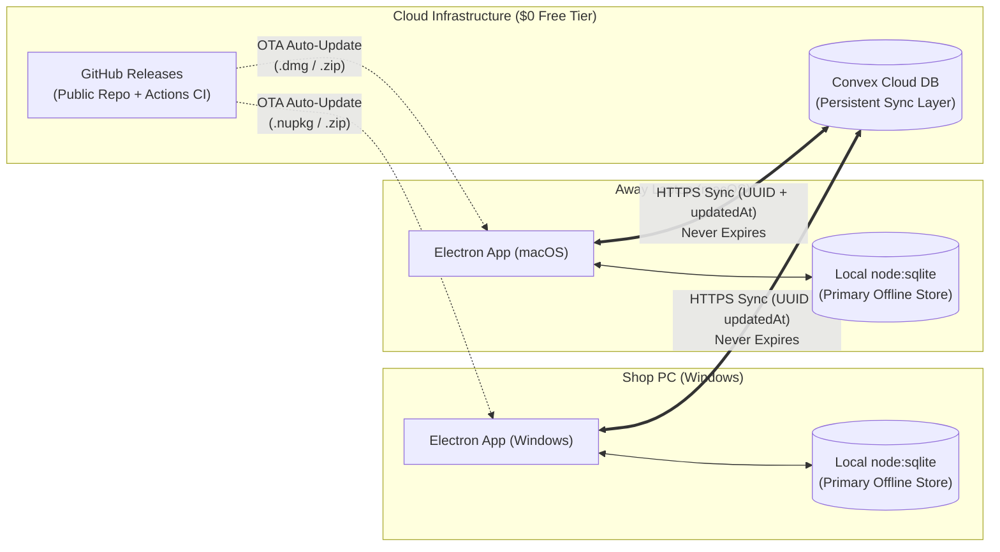

# Implementation Plan: Public Repo Auto-Updates, macOS/Windows Installers & Convex Cloud Sync

This document outlines the two-phase architecture for:

1. **Phase 1 — Public GitHub Repository, Auto-Updates & Cross-Platform Installers (Windows Shop PC + macOS Laptop)**: Ship the current local-first app with automatic over-the-air (OTA) updates and automated Windows (`.exe`) + macOS (`.dmg` / `.zip`) installers via GitHub Actions.
2. **Phase 2 — Offline-First Convex Cloud Sync**: Once he validates the workflow in real shop use, push a seamless update that adds automatic two-way sync between the Windows Shop PC and his MacBook without ever expiring login sessions.

---

## Architecture Overview



---

## Phase 1: Public Repo, Automated Windows/Mac Installers & Auto-Updates

Because the app uses Node's built-in `node:sqlite` (`DatabaseSync` in [`src/main.ts`](../src/main.ts)) rather than native C++ SQLite addons (`better-sqlite3`), **zero native C++ compilation is required** during packaging. GitHub Actions can build both Windows and macOS installers cleanly out of the box.

### 1.1 Pre-Public Repository Security Checklist

Before flipping the GitHub repository to **Public**:

1. **Verify `.gitignore`**:
   - Ensure `*.sqlite`, `*.sqlite-wal`, `*.sqlite-shm`, `*.db`, `.env*`, and `out/` are ignored so no real customer data or local OAuth tokens are ever committed.
2. **Zero Hardcoded Secrets**:
   - Google OAuth Client ID / Client Secret ([`src/gmailAuth.ts`](../src/gmailAuth.ts)) and Resend/Gmail credentials ([`src/main.ts`](../src/main.ts)) are already stored in the local `app_settings` table (encrypted on disk via Electron `safeStorage`), not in source code.
3. **Remove Unused `allowScripts` Entry in [`package.json`](../package.json)**:
   - Remove the leftover `"better-sqlite3@13.0.3"` entry under `allowScripts` in `package.json`.

### 1.2 Electron Forge Configuration ([`forge.config.mts`](../forge.config.mts))

Update `forge.config.mts` to produce:

- **Windows**: `MakerSquirrel` (`.exe` installer + `.nupkg` delta packages for background auto-updates).
- **macOS**: `MakerDMG` (for an easy first-time drag-to-Applications `.dmg` installer on his MacBook) + `MakerZIP` (`['darwin']`, required by macOS Squirrel for in-app auto-updates).
- **GitHub Publisher**: `@electron-forge/publisher-github` so `electron-forge publish` uploads installers directly to GitHub Releases.

```ts
// Proposed additions to forge.config.mts
import { MakerSquirrel } from '@electron-forge/maker-squirrel';
import { MakerZIP } from '@electron-forge/maker-zip';
import { MakerDMG } from '@electron-forge/maker-dmg';
import { PublisherGithub } from '@electron-forge/publisher-github';

// Inside config:
makers: [
  new MakerSquirrel({
    name: 'katia_body_shop',
  }),
  new MakerZIP({}, ['darwin']),
  new MakerDMG({}, ['darwin']),
],
publishers: [
  new PublisherGithub({
    repository: {
      owner: '<YOUR_GITHUB_USERNAME>',
      name: '<YOUR_REPO_NAME>',
    },
    prerelease: false,
    draft: false,
  }),
],
```

### 1.3 In-App Auto-Updater ([`src/main.ts`](../src/main.ts))

Install `update-electron-app` (the official Electron team package that polls `update.electronjs.org` backed by your public GitHub Releases):

```bash
npm install update-electron-app
```

In [`src/main.ts`](../src/main.ts), initialize auto-updates right after `app.whenReady()`:

```ts
import { updateElectronApp } from 'update-electron-app';

if (app.isPackaged) {
  updateElectronApp({
    repo: '<YOUR_GITHUB_USERNAME>/<YOUR_REPO_NAME>',
    updateInterval: '1 hour',
  });
}
```

- **How it works on his PC**: Whenever you bump `"version"` in `package.json` (e.g., `1.0.0` -> `1.1.0`) and push a tag `v1.1.0`, his Shop PC downloads the update silently in the background and prompts him (or applies it automatically the next time he opens the app) without touching his `%APPDATA%\Katia Body Shop\katia-body-shop.sqlite` database.

### 1.4 GitHub Actions Workflow (`.github/workflows/release.yml`)

Create `.github/workflows/release.yml` to build both the **Windows `.exe`** and **macOS `.dmg` + `.zip`** automatically on every `v*` tag push:

```yaml
name: Build & Publish Release (Windows & macOS)

on:
  push:
    tags:
      - 'v*'

permissions:
  contents: write

jobs:
  release:
    strategy:
      fail-fast: false
      matrix:
        os: [windows-latest, macos-latest]

    runs-on: ${{ matrix.os }}

    steps:
      - name: Checkout repository
        uses: actions/checkout@v4

      - name: Setup Node.js 22
        uses: actions/setup-node@v4
        with:
          node-version: '22.17.0'
          cache: 'npm'

      - name: Install dependencies
        run: npm ci

      - name: Run typecheck & tests
        run: |
          npm run typecheck
          node src/customerHistory.test.cjs
          node src/backupService.test.cjs

      - name: Publish installers to GitHub Releases
        env:
          GITHUB_TOKEN: ${{ secrets.GITHUB_TOKEN }}
        run: npx electron-forge publish
```

> [!NOTE]
> **macOS Gatekeeper Note (Unsigned vs. Signed Builds)**
> If building without a paid `$99/yr` Apple Developer ID certificate, macOS will show an "unverified developer" prompt the first time he opens the `.dmg` on his MacBook. He only has to right-click the app in `Applications` -> click **Open** (or run `xattr -cr "/Applications/Katia Body Shop.app"` once in Terminal), and macOS permanently whitelists it on his laptop.

---

## Phase 2: Offline-First Convex Cloud Sync

Once he is actively using the app and ready for automatic Shop PC <-> MacBook syncing, we ship **v1.1.0** with **Convex Cloud Sync**.

### 2.1 Why Offline-First (Local SQLite + Convex)?

- **Zero UI Rewrites & Instant Speed**: All existing IPC handlers (`work-orders:list`, `work-orders:create`, `work-orders:update`, PDF generation) continue reading/writing local SQLite first in `< 1ms`.
- **100% Offline Shop Reliability**: If shop Wi-Fi drops, he can still write estimates, generate PDFs, and print receipts.
- **Never Expires**: Unlike Google OAuth tokens in testing mode, Convex uses a persistent **Deployment URL** (`https://<project>.convex.cloud`) and a shared **Sync Access Key** stored in `app_settings`. Neither PC nor MacBook is ever logged out.
- **PDFs Stay Local**: PDF buffers are generated on-demand via [`receiptHtml`](../src/receipt.ts) and never stored in Convex, keeping cloud storage tiny (a few KB per invoice) and permanently within Convex's `$0/mo` Free Tier.

### 2.2 Local SQLite Schema Additions ([`src/main.ts`](../src/main.ts))

Add lightweight sync tracking metadata to the existing SQLite tables via safe `PRAGMA table_info` migrations:

1. **`work_orders` columns**:
   - `updated_at TEXT NOT NULL DEFAULT ''` — ISO-8601 timestamp updated on every create, edit, status change, or email delivery.
   - `sync_dirty INTEGER NOT NULL DEFAULT 1` — `1` when modified locally and awaiting push to Convex; `0` once acknowledged by Convex.
2. **`customer_contacts` columns**:
   - `updated_at TEXT NOT NULL DEFAULT ''`
   - `sync_dirty INTEGER NOT NULL DEFAULT 1`
3. **`deleted_work_orders` tombstone table**:
   ```sql
   CREATE TABLE IF NOT EXISTS deleted_work_orders (
     id TEXT PRIMARY KEY,
     deleted_at TEXT NOT NULL,
     sync_dirty INTEGER NOT NULL DEFAULT 1
   );
   ```
   When he deletes an order on the Shop PC, recording its `id` in `deleted_work_orders` ensures the Laptop also removes that order on its next sync (instead of re-uploading it).

### 2.3 Convex Backend Schema (`convex/schema.ts`)

```ts
import { defineSchema, defineTable } from 'convex/server';
import { v } from 'convex/values';

export default defineSchema({
  workOrders: defineTable({
    orderId: v.string(), // Matches SQLite work_orders.id (UUID)
    orderNumber: v.string(), // e.g. "RO-00042"
    customerName: v.string(),
    vehicle: v.string(),
    status: v.string(),
    dataJson: v.string(), // Full serialized WorkOrder JSON (charges, signature, etc.)
    createdAt: v.string(),
    updatedAt: v.string(), // LWW (Last-Write-Wins) ISO timestamp
    deletedAt: v.optional(v.string()),
  })
    .index('by_orderId', ['orderId'])
    .index('by_orderNumber', ['orderNumber'])
    .index('by_updatedAt', ['updatedAt']),

  customerContacts: defineTable({
    customerKey: v.string(), // Matches SQLite customer_contacts.customer_key
    name: v.string(),
    phone: v.string(),
    address: v.string(),
    email: v.string(),
    updatedAt: v.string(),
  })
    .index('by_customerKey', ['customerKey'])
    .index('by_updatedAt', ['updatedAt']),

  shopSettings: defineTable({
    key: v.string(), // 'tax_settings' | 'next_order_number'
    valueJson: v.string(),
    updatedAt: v.string(),
  }).index('by_key', ['key']),
});
```

### 2.4 Conflict Resolution Rules (`convex/sync.ts` & `src/convexSync.ts`)

Reuses the proven collision resolution logic already built in [`src/backupService.ts`](../src/backupService.ts):

1. **Same `orderId` (UUID) Edited on Both Machines**:
   - Compare `updatedAt` timestamps (**Last-Write-Wins**). The newer `updatedAt` wins.
2. **Different `orderId` (UUID) with Colliding `orderNumber` (`RO-00042`)**:
   - If he created `RO-00042` offline at the shop and also created a different `RO-00042` offline on his laptop before syncing:
   - The earlier `createdAt` keeps `RO-00042`.
   - The second order is automatically assigned the next available `RO-XXXXX` number via `allocateNextOrderNumber()`, and `next_order_number` is advanced to `max + 1`. **Zero invoices are ever overwritten or lost.**
3. **Auto-Seeded Demo Orders**:
   - Any auto-seeded `'Demo Customer'` or `'Morgan Example (DEMO)'` orders are never pushed to Convex and are automatically replaced when real cloud orders arrive.

### 2.5 Sync Lifecycle in the Electron App (`src/convexSync.ts`)

Using `ConvexHttpClient` (from `convex/browser`) inside the Electron main process:

1. **On App Launch**:
   - Pull all records from Convex where `updatedAt > last_sync_cursor`, apply them to local SQLite in a single `BEGIN IMMEDIATE` transaction, and notify the renderer (`mainWindow.webContents.send('sync:updated')`) to refresh state if any changes arrived.
2. **On Local Write (`saveWorkOrder`, `updateWorkOrder`, `setWorkOrderStatus`, `deleteWorkOrder`, `saveCustomerContact`, `saveSettings`)**:
   - Write to local SQLite immediately (`sync_dirty = 1`).
   - Trigger an async background `pushDirtyRecordsToConvex()` call (debounced by `500ms`). If offline, it silently stays `sync_dirty = 1` and flushes automatically on the next successful connection.
3. **Periodic / Window Focus Sync**:
   - Whenever the Electron window regains focus (`BrowserWindow.on('focus')`) or every `60 seconds` while open, pull any new changes from Convex.

### 2.6 UI Additions in `Settings -> Backups` ([`src/settings/BackupsTab.tsx`](../src/settings/BackupsTab.tsx))

Add a **Cloud Sync (Convex)** card at the top of `BackupsTab.tsx` (strictly adhering to the `--radius-lg: 12px` / `--radius-md: 8px` token scale):

- **Inputs**:
  - `Convex Deployment URL` (`https://xxxx.convex.cloud`)
  - `Sync Access Key` (password-masked shared secret verified by Convex mutations/queries)
- **Status Indicator & Actions**:
  - Live badge: `Synced (Just now)`, `Syncing...`, or `Offline (2 changes queued locally)`
  - Buttons: **Test & Save Connection** and **Sync Now**.

---

## Step-by-Step Rollout Sequence

| Step  | Action                                                                                  | Outcome                                                                                                                         |
| :---- | :-------------------------------------------------------------------------------------- | :------------------------------------------------------------------------------------------------------------------------------ |
| **1** | Create public GitHub repo & add `.github/workflows/release.yml` + `update-electron-app` | Push `v1.0.0` tag -> GitHub Actions builds Windows `.exe` and macOS `.dmg`/`.zip` automatically.                                |
| **2** | Install `v1.0.0` on his Shop PC (Windows) and Laptop (MacBook)                          | He tests creating, printing, and emailing invoices; uses one-click `.json`/`.sqlite` backup in `Settings -> Backups` if needed. |
| **3** | Initialize Convex project (`npx convex dev --once`) & implement `src/convexSync.ts`     | Push `v1.1.0` tag -> Both his Shop PC and MacBook auto-update to include real-time Convex sync.                                 |
